<div align="center">

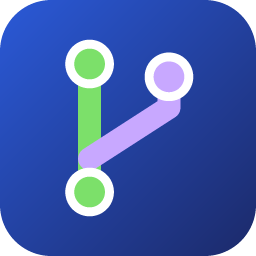

# RefBraid

**A desktop client for Git**: the history as a commit graph, a branch tree, diffs,
merge conflicts, pull requests and CI — in one window.<br>
A native program written in Rust, for Linux, Windows and macOS.

[](https://github.com/alexeylovchikov/refbraid/releases/latest)
[](https://github.com/alexeylovchikov/refbraid/actions/workflows/ci.yml)
[](LICENSE)


[Download](https://github.com/alexeylovchikov/refbraid/releases/latest) · [Changelog](app/CHANGELOG.en.md) · [Roadmap](app/ROADMAP.md)

</div>

RefBraid shows the history with a commit graph and a branch tree, has a commit panel,
diffs, push and pull, merge-conflict resolution and more. It is written in Rust with
[egui](https://github.com/emilk/egui) and drives the `git` program you already have, so
everything it does is an ordinary git command you can see in its Console tab.

The name: git calls branches and tags *refs*, and the commit graph braids them together.
Before its first public release the program was developed under the working name
"Git Explorer"; settings from that time are picked up on the first start.


| Commit panel, light theme | Diff | Merge conflicts |
|---|---|---|
|  | 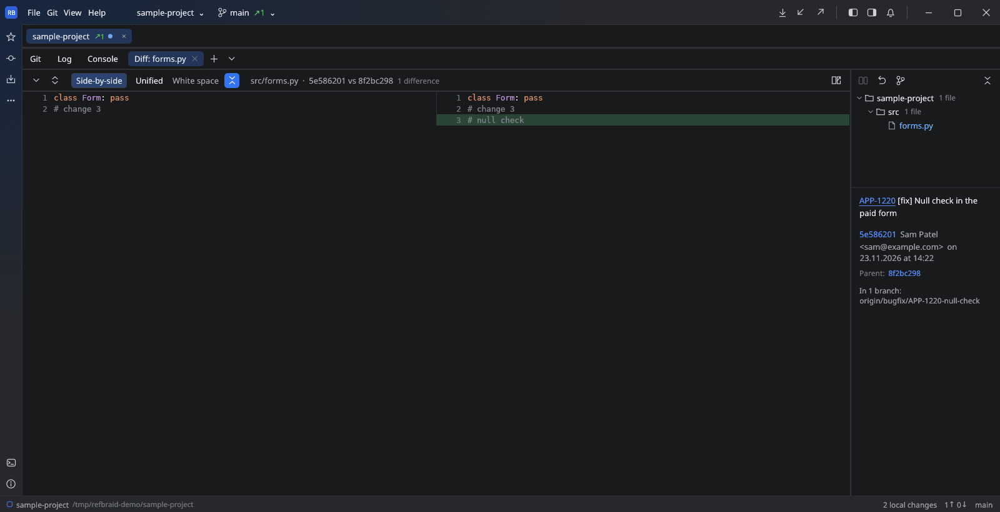 | 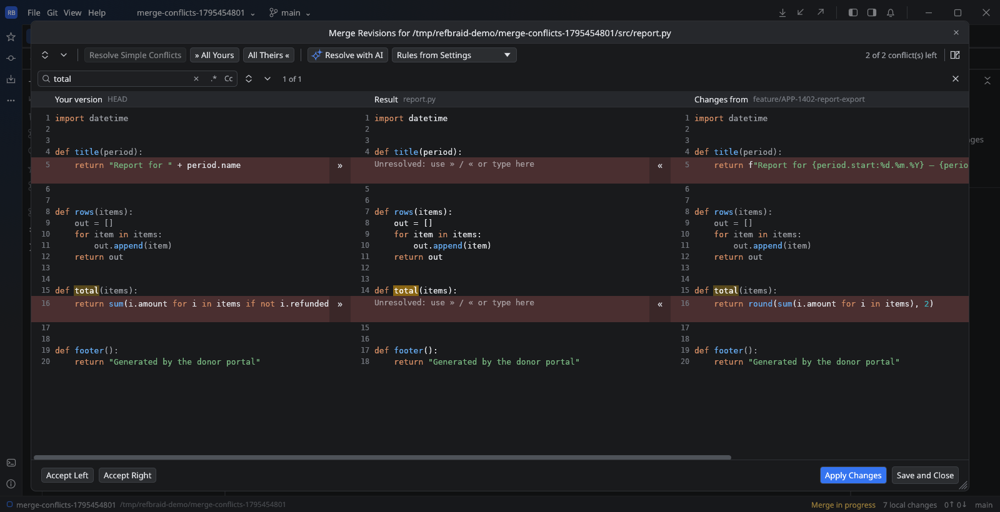 |

| CI results in the Log | Create Pull Request | Settings → Hosting |
|---|---|---|
| 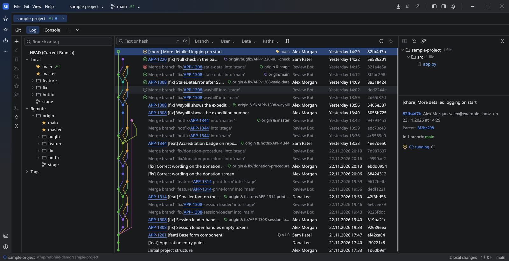 | 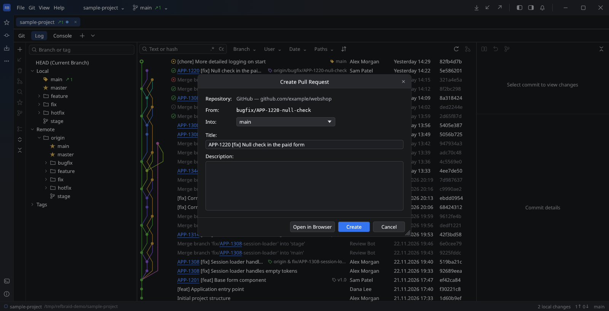 | 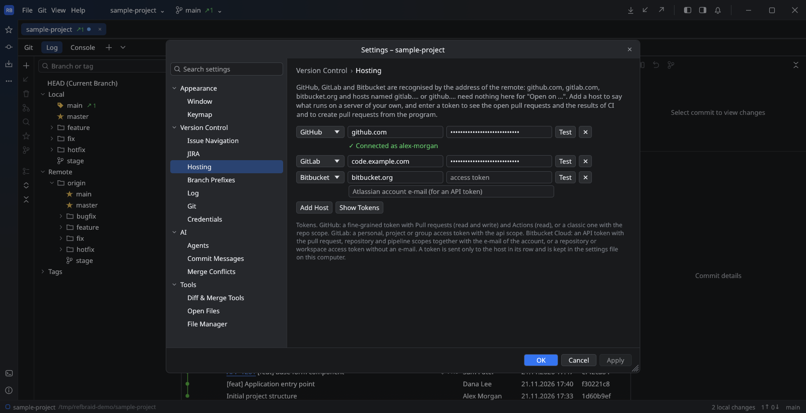 |

| AI: a rebase plan | AI: atomic commits | AI: commit message prompt |
|---|---|---|
| 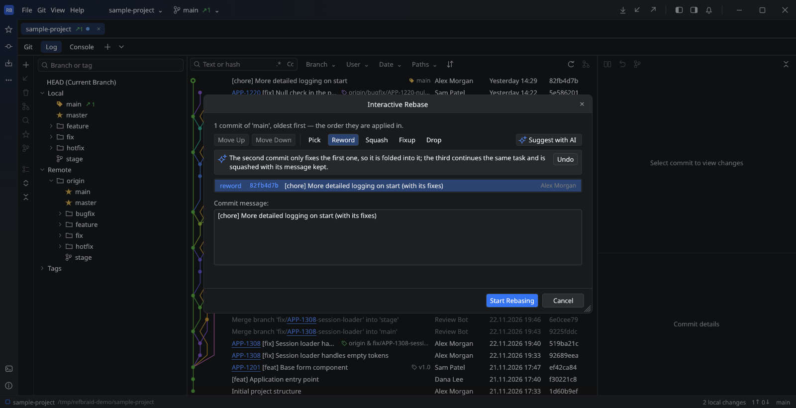 | 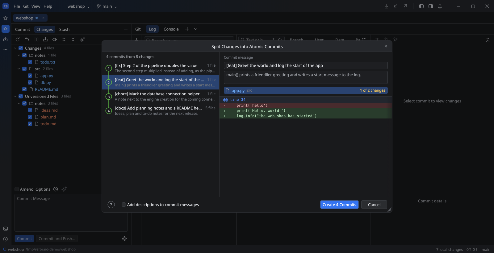 | 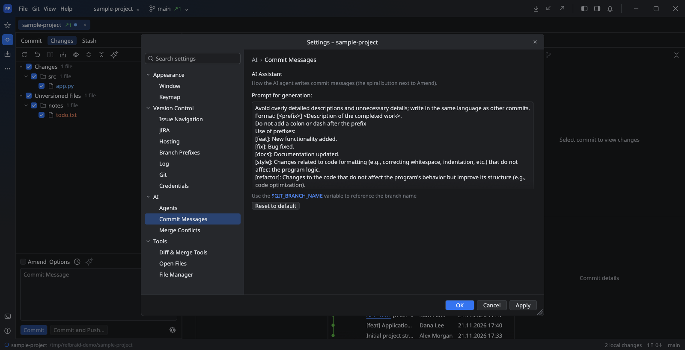 |

| Reflog | Find Action | JIRA status |
|---|---|---|
| 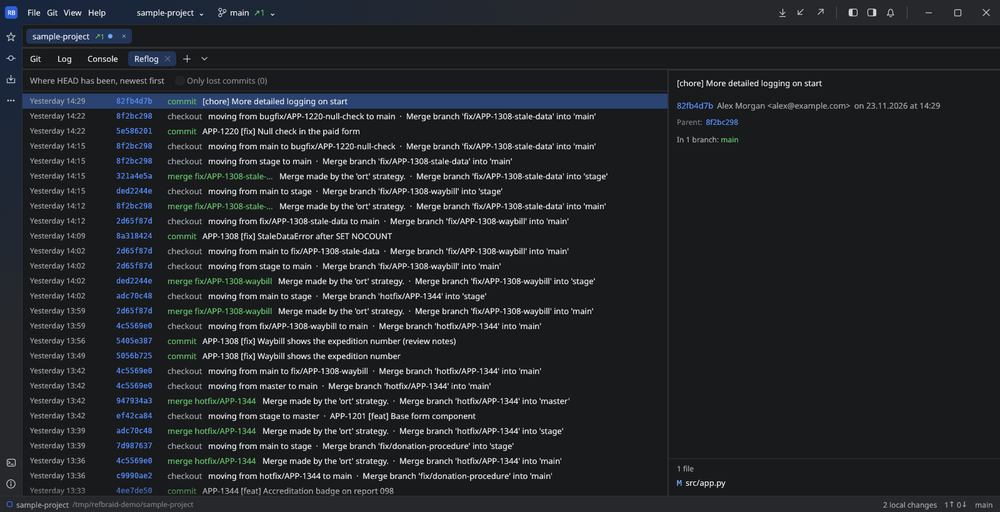 | 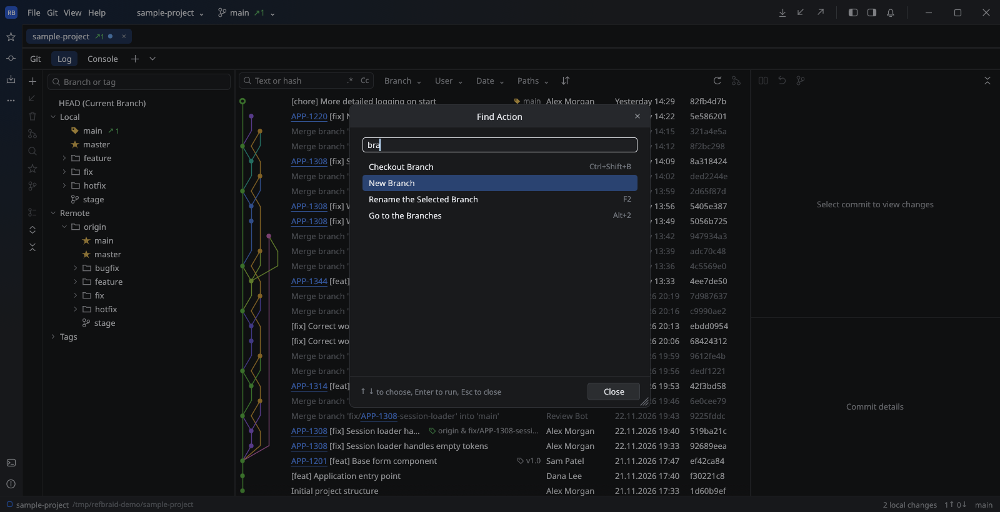 | 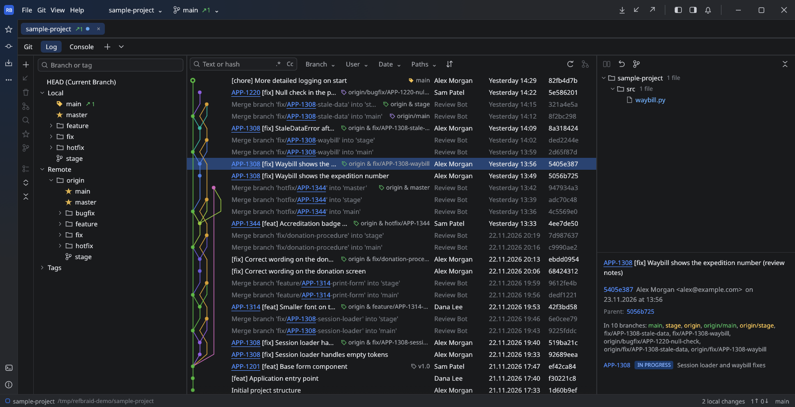 |

## What it does

- **Log** — commit graph, branch tree with favourites, filters by text, branch, author, date
  and path; search of the whole history; file history and history of selected lines; several
  Log tabs.
- **Commit** — changed files as a tree, partial commits (single changes of a file), amend,
  commit options (sign-off, signature, author, date), stash with a look inside, `.gitignore`
  helpers.
- **Diff** — side by side or unified, word-level changes, syntax colouring, search,
  white-space modes, keyboard text selection, pictures, external diff tools.
- **Branches and history** — merge with options, interactive rebase, cherry-pick and revert,
  reset, tags, worktrees, bisect, reflog, undo of the last action.
- **Conflicts** — a three-column merge window (yours · result · theirs), simple conflicts
  resolved in one click, optional help from an AI coding agent you have installed.
- **Remotes** — fetch, pull, push with a preview of the commits, clone, credentials and SSH
  keys, sign-in errors explained in plain words.
- **AI** — with a coding-agent CLI you have installed (Claude Code, Codex, Gemini and
  others): commit messages by a prompt you can change, the local changes split into atomic
  commits, a plan suggested for an interactive rebase, merge conflicts resolved.
- **Hostings** — GitHub, GitLab and Bitbucket are recognised by the address of the remote:
  open a commit, a branch or a file on the hosting, create a pull request, see the open
  pull requests of a branch and the result of CI next to each commit (the last two need a
  token in the settings).
- **Comfort** — several repositories as tabs, light and dark themes, a keymap you can change,
  a command palette, English and Russian interface.

The full list of changes by version is in [app/CHANGELOG.en.md](app/CHANGELOG.en.md)
([по-русски](app/CHANGELOG.md)); what is planned is in [app/ROADMAP.md](app/ROADMAP.md).

## Requirements

- Git on the `PATH` (on Windows: [Git for Windows](https://git-scm.com)). The program is developed
  and tested with Git 2.52.0; much older versions lack some of the commands it uses
  (`git restore`, for one, appeared in Git 2.23).
- Linux (X11 or Wayland) or Windows 10 / 11, 64-bit.
- macOS 11 or newer (Apple silicon or Intel) — experimental: the application is built and
  started by CI, but has not been tried on a real Mac yet. It is not notarised, so macOS
  refuses the first start: allow it in System Settings → Privacy & Security → Open Anyway.

## Build and run

```bash
cd app
cargo run                 # or: cargo run -- /path/to/repository
cargo test
```

Installers (RPM, deb, AppImage, Windows MSI and zip) are built with `make dist`, the macOS
`.dmg` with `make macos` on a Mac; see
[app/packaging/README.md](app/packaging/README.md). `make` with no target lists every command.

## Origin

RefBraid is an independent project **inspired by the Git tool window of JetBrains IDEs**:
people who know it will find the log, the branch tree and the commit panel where they expect
them. It is not a port of that tool and shares no code or resources with it, and by now it
has a number of things of its own.

It was developed clean-room: from descriptions of behaviour and from what any user sees on
the screen. No source code, binaries, resources, icons or fonts of any JetBrains product — or
of any other Git client — were read, decompiled or copied. Every icon in the program,
including the application icon, is drawn in code; the repository contains no third-party
images.

A large part of the code was written with AI coding assistants, under the author's direction
and review.

## Licence

RefBraid is released under the [MIT licence](LICENSE).

The program file contains open-source libraries and fonts under their own licences (MIT,
Apache-2.0, BSD, Zlib, ISC, BSL-1.0, Unicode-3.0, SIL OFL 1.1, Ubuntu Font Licence 1.0).
They are listed with their licence texts in [THIRD-PARTY-NOTICES.md](THIRD-PARTY-NOTICES.md),
which is also installed next to the program.

The software is provided "as is", without warranty of any kind — see the licence. It runs
git commands on your repositories; keep backups of work that matters.

## Trademarks

JetBrains, IntelliJ IDEA and PyCharm are trademarks of JetBrains s.r.o. Git and the Git logo
are trademarks of Software Freedom Conservancy, Inc. GitHub, GitLab, Bitbucket, Jira, Windows,
Linux and other names mentioned here or in the program belong to their owners. They are used
only to say what the program works with or was inspired by. RefBraid is not affiliated
with, sponsored or endorsed by any of these companies or projects, and is not an official
Git project.

## Contributing

See [CONTRIBUTING.md](CONTRIBUTING.md).
